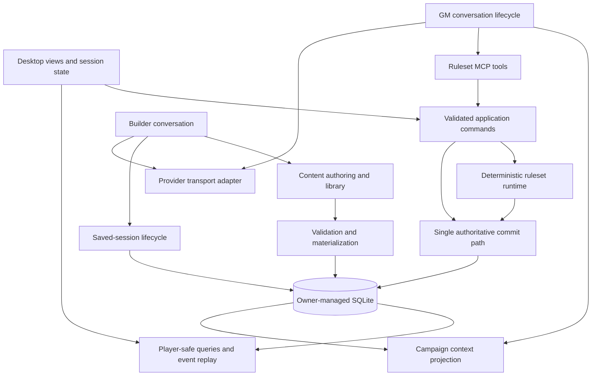

# How I would build Sylvia GM from scratch

Prepared for Wan, 12 September 2026. Advisory research and design judgment, not an implementation selection or a replacement for the active contracts.

**I would keep Sylvia's central idea and much of its current architecture. I would change the order in which I proved the product, give the main modules smaller interfaces, and spend more design effort on the agreement between game state, narrative memory, and what the player sees.** I would not recommend another whole-project rewrite on the evidence I reviewed.

You asked what I would do differently as Astra after the original DeepSeek V4 work and the Sol rewrite. This is my assessment with the benefit of the current repository and its recorded failures. I cannot attribute individual decisions to those models from this checkout, or establish that I would have avoided the same mistakes with the original information and constraints. A model name is not evidence that an architectural choice is better.

I reviewed the working copies of the active product, architecture, process, and status documents; representative production code for ownership, persistence, Builder, GM orchestration, packages, and the desktop; selected test implementations; and three recorded synthetic-test findings. HEAD was `b251b1dddd98201287e253beba6b1a0e3d6905b4`. The checkout already contained substantial documentation and ticket changes, so this is an assessment of that working state, not a claim that every cited document matches committed HEAD. I did not run Sylvia, execute model calls, inspect private campaign data or raw audits, or rerun the test suite. Reported installed outcomes below are explicitly attributed to existing records.

The [Documentation Authority Index](../INDEX.md) identifies the governing documents. In particular, the [Alpha Launch Contract](../product/alpha-launch-contract.md) defines the product promise, and the [Alpha Architecture Contract](../architecture/alpha-architecture-contract.md) defines how the software must work. Suggestions here that change either contract remain proposals.

## What I would keep

The current architecture is already a local modular monolith: one application running in a supervised owner process, with internal modules and one SQLite database. That is a good fit for your stated preference for maintainable software that one person can ship. It does not need a distributed backend merely because many people might install it. Separate local installations have separate campaign databases. A future hosted multiplayer product would raise a different set of questions. [Architecture contract, sections 2–7](../architecture/alpha-architecture-contract.md).

I would retain the distinction between the model's judgment and the engine's authority. The model decides how to interpret a player action and run the fiction; encoded mechanics execute through validated tools. An action's result survives a later failure to narrate it. This is a necessary property of an AI GM that rolls dice or spends resources, and the current code already takes it seriously. [Action execution](../../src/sylvia_gm/application/authority.py), [SQLite action commit](../../src/sylvia_gm/infrastructure/sqlite_authority.py), [atomicity and duplicate-action test](../../tests/test_alpha_f1_neutral_authority.py).

SQLite supports atomic transactions and serializes writes. Those properties suit a short transaction containing an action's state changes and durable receipt, while model inference remains outside it. Sylvia's architecture already selects that arrangement. Its explicit action identities also follow the established reasoning behind idempotency: a retry must be distinguishable from a deliberate second identical action. [SQLite atomic commit](https://www.sqlite.org/atomiccommit.html), [SQLite isolation](https://www.sqlite.org/isolation.html), [AWS on idempotent requests](https://aws.amazon.com/builders-library/making-retries-safe-with-idempotent-APIs/).

I would also retain exact package versions, explicit adoption of updates, separate reusable content and live campaign state, independent saved Builder conversations, and a ruleset-neutral core. A campaign should not change underneath its player when a source Setting or Ruleset changes. Builder should not lose its work because the player navigates elsewhere. These are already explicit current decisions, with corresponding persistence, package, and session implementations. [Package library](../../src/sylvia_gm/domain/package_library.py), [Builder session storage](../../src/sylvia_gm/infrastructure/sqlite_session.py), [product contract, sections 2.1 and 6](../product/alpha-launch-contract.md).

Declarative package mechanics and host-rendered panels are also sensible. The package runtime receives copied state and returns an outcome; it does not receive the database handle. The result-card projector reads explicitly supplied public data and saves a detached presentation. I would build on those existing seams, meaning the places where one module meets another through a defined interface. [Package runtime](../../src/sylvia_gm/application/package_runtime.py), [result-card projection](../../src/sylvia_gm/application/result_cards.py).

## Where I would make different decisions

| Area | My from-scratch choice | Relationship to current Sylvia |
|---|---|---|
| Initial product proof | One satisfying installed play journey, including interruption and restart | Current process agrees; I would make this the earliest development constraint |
| Campaign ownership | One writer with a few cohesive internal interfaces | One writer exists; its main interface has become very broad |
| Ruleset neutrality | Packages supply mechanical meaning for narration as well as execution | Shared narration code still knows specific D&D-shaped fields |
| Narrative memory | Store references to mechanical facts instead of editable duplicate values | Mechanical ownership exists; contradictory narrative copies remain possible |
| GM orchestration | One model-led conversation inside an explicit lifecycle | Broadly selected already; policy is concentrated in a provider adapter |
| Builder | Discover and bind prerequisites within any ordinary saved Builder chat | Some capabilities currently depend on how the chat was launched |
| Content authoring | Human-readable source, deterministic materialization, precise repair errors | Much already exists and should be consolidated, not replaced |
| Desktop UI | Typed events and independently owned session/view state | Current JavaScript has useful extracted modules but a large shared coordinator |
| Model suitability | Evidence by task and capability, with unknowns visible | Current contract additionally requires an ordered ten-tier scale |
| Verification | Mechanical assertions plus short human-reviewed narrative scenarios | Current process agrees; narrative failures deserve more influence on priorities |

### 1. I would prove the play experience before expanding the platform

My first deliverable would be an installed app in which a player can choose prepared content, begin, make a meaningful choice, resolve a mechanic, see its consequence, stop, and resume coherently. I would use a small authored slice of an existing supported Ruleset. A separate no-rules example would test whether the core had accidentally acquired D&D assumptions. Neither requires inventing another bundled game.

I would test cancellation and restart during this early slice. They change the shape of a conversation product: a player needs to understand whether an action happened and what Retry will do. Postponing those questions leaves both the database and the UI designed around an uninterrupted happy path.

Builder would follow with a similarly complete proof: create one small Setting, repair an actual validation error, save it, select it in an Interview, and play it. Only after that would I expand the authoring language and library experience. The test of a creation tool is whether its output becomes usable content.

This is a hypothetical sequencing choice. It is not a claim that maps or Trigger Discipline were unauthorized distractions; the current product contract explicitly selects those capabilities. Nor does it reopen completed ruleset milestones. Your [Development Process](../operations/quality-preserving-development-process.md) already says to prefer complete playable slices and proportionate tests. I would have used that rule from the earliest architectural experiment.

The main advantage would be earlier discovery of disagreements between parts that each look correct in isolation. The cost would be slower initial growth in feature breadth. For your project, I think that trade would have been worthwhile.

### 2. I would separate single-writer authority from a single enormous interface

The clearest maintainability concern is the concentration of responsibilities. I counted physical lines in the current source files, including comments and blank lines:

| File | Lines | Observed responsibilities |
|---|---:|---|
| `application/authority.py` | 8,307 | Sessions, campaign construction, actions, packages, panels, lifecycle, narration, queries |
| `infrastructure/sqlite_authority.py` | 12,630 | Persistence, migrations, action commits, chronology, lifecycle and recovery orchestration |
| `agent/_provider_session.py` | 4,826 | Provider events, gameplay context, tool handling, narration, Campaign File submission and recovery |
| `src-tauri/frontend/app.js` | 8,486 | Navigation, saved chats, construction, models, streams, panels, maps and display state |

An AST count found 135 public methods on `AuthorityOwner` and 101 on `SQLiteAuthorityStore`, counting methods defined directly on each class whose names do not begin with an underscore. The Python source tree contains 116,011 physical lines across 258 files; that includes retained legacy code and is not a measure of the installed execution path.

These counts are navigation evidence, not a quality score. A large implementation can be appropriate behind a small interface. Here, the stronger concern is that callers can reach many unrelated responsibilities through the same object. The application owner also directly names `SQLiteAuthorityStore`, so the persistence abstraction described in the architecture document is not fully expressed at that constructor. [Application owner](../../src/sylvia_gm/application/authority.py), [SQLite store](../../src/sylvia_gm/infrastructure/sqlite_authority.py).

From scratch, I would organize the internal work around campaign commands, campaign queries, content compilation/library operations, and saved-session lifecycle. One composition point would wire them together. The same database ownership and command serialization would remain in force. I would avoid a universal command bus that merely hides an equally broad set of operations behind string names.

For example, a caller asking to perform an action should provide a validated command and receive its stored receipt. It should not also need the interface that installs a Ruleset, enumerates Builder references, prepares panels, and exports a campaign. The module earns its depth by hiding the admission, execution, transaction, and duplicate-request behavior behind that small interface.

There are already useful extractions such as `player_actions.py`, `result_cards.py`, and the specialized SQLite modules. I would continue in that direction only when changing their owning behavior. Splitting files without reducing what callers need to know would accomplish little.

### 3. I would make ruleset-neutral narration a first-class package responsibility

The current shared provider-session code contains `_mechanics_narration_facts`. It explicitly selects fields such as `_d20_test`, `_proficiency_bonus`, `_effective_target_armor_class`, `_critical_hit`, and weapon damage, and computes an HP difference from entities' `hp` values. The function is called after mechanics and during recovery. This is a concrete place where ruleset-specific knowledge remains outside the package. [Narration projection and its callers](../../src/sylvia_gm/agent/_provider_session.py).

That does not mean other Rulesets cannot run. It means the shared harness understands the explanation of some mechanics more specifically than others, and adding another game risks adding another interpretation branch there.

I would have each Ruleset declare which result facts matter to the GM: the acting and affected identities, relevant before/after values, outcomes, costs, and any explanatory labels. The owner would validate and project those declarations from the committed result. It would carry the exact action and revision identities so the explanation remained tied to what happened.

The player-facing subset would be selected separately. The GM may legitimately know a hidden resistance or unrevealed actor detail that a card must not display. A single unfiltered result object passed everywhere would undermine that distinction.

Sylvia already has much of the necessary pattern in its declarative result cards and public-context handling. I would extend the owning result declaration only as far as needed for narration, sharing the underlying facts without making UI formatting the model's knowledge contract. This would be a focused evolution of package results, not another state store or a second mechanics engine. [Result-card implementation](../../src/sylvia_gm/application/result_cards.py), [result-card schema](../../src/sylvia_gm/domain/_content_schema_map_card.py).

### 4. I would prevent mechanical facts from becoming independently editable narrative facts

This is the change I would investigate most seriously before adding more game systems.

The preserved PES-90 finding reports that a movement action committed correctly and its card showed the correct result. The model nevertheless narrated an incorrect remaining resource value and saved contradictory mechanical values into narrative entity and progress notes. The diagnosis records that the model had received the correct current values. It does not establish that missing context caused the mistake. [PES-90 investigation](../../.scratch/player-experience-strategy-2026-09-06/issues/90-chat-move-narration-invents-ap-and-stance.md).

There is already one mechanical authority. The remaining problem is that narrative memory can become a competing account which the model reads later. A database can enforce perfect ownership of an AP field while still storing a sentence elsewhere that says the actor has a different AP value.

From scratch, I would distinguish writable narrative facts from references to current mechanical facts. A narrative entity could refer to its corresponding ruleset entity. Its current resources, position, and other package-owned properties would be projected from that entity when needed. A historical note could refer to an action receipt and its then-current result. It would not present an old value as a current editable property.

The Ruleset would identify its owned structured fields. Deterministic admission could reject an attempted duplicate mechanical property in structured narrative updates and return a useful correction. This can be ruleset-neutral; it does not require hard-coding AP or HP names in core code.

Free prose is harder. A character can lie about ammunition, recall an earlier injury, or discuss a hypothetical attack. I would not claim that a keyword filter can reliably distinguish those from an erroneous statement of present mechanics. Structured ownership reduces the opportunity for contradiction but does not prove that narration is correct. The action card would remain authoritative, and the narrative failure would remain visible in evaluation.

This proposal changes the content and memory contract. It needs a deliberate choice about accepted fields, references, historical facts, and repair behavior before implementation. I would test it on a small synthetic case with an old narrative note and a newly committed mechanic. A generic prose-policing subsystem would be a much larger and less certain bet.

### 5. I would give gameplay policy an explicit home outside provider translation

The docstring of `ProviderSessionAdapter` describes translation from provider text and tool-call deltas into canonical events. Its actual implementation also assembles current campaign knowledge, interprets response blocks, supplies mechanics narration facts, manages Campaign File disposition, and handles many recovery conditions. Its `_events` method spans roughly two thousand lines. [Provider-session adapter](../../src/sylvia_gm/agent/_provider_session.py).

Much of that behavior is necessary. I would place it behind a GM-run module, with a smaller provider adapter responsible for the provider's request/stream format. The GM-run module would own the progress of one response and expose its status, cancellation, and continuation requirements to the saved-session layer.

The distinction between a game TURN and a provider attempt matters here. A TURN can contain committed actions and several provider exchanges. Losing a provider stream must not imply that the game action should be repeated. The current `CampaignSessionLoop` and retry records already recognize that distinction; I would simplify their interfaces around it. [Session loop](../../src/sylvia_gm/agent/_session_loop.py), [retry persistence test](../../tests/test_alpha_f2_event_protocol.py).

I would keep one model-led tool conversation. It should freely investigate, choose legal mechanics, improvise, and finish its response. The explicit lifecycle would govern when work is admitted, what has committed, when the model must yield, and what remains unfinished. It would not force every exchange through separate planner, critic, memory, and narrator agents.

Anthropic's workflow/agent distinction supports this separation of predictable application control from flexible model decisions, while recommending simple implementations before frameworks. That is supporting design guidance, not evidence that any particular orchestration library would improve Sylvia. [Building effective agents](https://www.anthropic.com/engineering/building-effective-agents).

I would also remove retired execution branches once their consumers and migration needs were understood. `AgentRunner` still supports current Builder work while retaining old DM-related code and constructor arguments; it explicitly rejects `DM_SESSION`. I would describe that as maintenance residue, not a second active desktop GM authority. [Builder runner](../../src/sylvia_gm/agent/_runner.py).

### 6. I would make Builder's prerequisites discoverable within the conversation

PES-100 is a particularly useful counterexample to blaming the model. The recorded plain Builder chat lacked Setting inspection/check/publication tools, and the diagnosis states that Sol's report of missing tools was accurate. The contextual New Setting flow supplied the needed launch context. Current source confirms that Setting check/publication callbacks are conditional on saved launch references and a candidate identity. [PES-100](../../.scratch/player-experience-strategy-2026-09-06/issues/100-sol-setting-builder-stops-with-missing-tools.md), [owner process Builder wiring](../../src/sylvia_gm/interfaces/owner_process.py).

I would make an ordinary Builder able to discover installed reusable content and explicitly bind a selected source to its current authoring work. Once the prerequisite is present, the applicable check and publication operations become available through the same machinery used by a contextual launch. Loading a skill supplies instructions; it should not be mistaken for satisfying an authority or content prerequisite.

The capability catalog should come from the same definitions that describe executable operations. It should distinguish an operation that is available, one that needs a Ruleset or Setting selection, and one that is outside the current session's authority. The model then has a supported route to satisfy the missing prerequisite, or can accurately explain why it cannot.

This does not imply exposing every mutation tool indiscriminately. A saved Builder session still cannot acquire control of an active campaign by asking for it. Its initial launch brief should also remain immutable evidence. Any later authoring selection would be recorded separately instead of silently rewriting why the chat was created.

I would verify this with the same small Setting request through both entry points: an ordinary Builder conversation and the Interview's New Setting button. They need not have identical messages, but they should reach the same validated content outcome when given the same authority and source selection. This is a narrowly scoped product improvement with stronger evidence than a speculative overhaul of Builder prompting.

### 7. I would treat authoring formats as a compiler interface from the beginning

The user and Builder should primarily express game intent and authored content. Deterministic code should derive the mechanical packaging details, including file indexes, hashes, immutable snapshots, and runtime expansion. Sylvia already does substantial work in this direction: `ruleset-source.yaml`, materializers, shared content definitions, and draft checks all exist. [Content-format reference](../reference/content-formats.md), [definition registry](../../src/sylvia_gm/domain/content_definitions.py), [Setting materializer](../../src/sylvia_gm/builder/_setting_materializer.py).

I would consolidate those paths around a clear distinction between editable authoring inputs and generated package bytes. Where byte-canonical JSON is required for an immutable package, the compiler should ordinarily normalize a valid authored structure before producing those bytes. Invalid or ambiguous data, such as duplicate keys, should still reject. Requiring a model to repair harmless JSON formatting in an authoring file is avoidable work if canonicalization belongs to materialization.

This is relevant to the resolved PES-101 finding. Its original title suggested a generated-manifest defect, but diagnosis showed that an authored Setting knowledge file was noncanonical and the error named the wrong file. The recorded fix supplied the correct diagnostic; Sol then repaired, validated, and published the saved draft. I would preserve that fix and use the incident to examine where formatting requirements belong. I am not reporting PES-101 as open. [PES-101 diagnosis and recorded recovery](../../.scratch/player-experience-strategy-2026-09-06/issues/101-setting-publication-generates-noncanonical-manifest.md).

One admission implementation should own each rule. Draft checking, import, and publication should call it with the appropriate side effects disabled or enabled. Documentation and examples should derive from those declarations where possible, with procedural constraints documented beside them. A successful format check must say what it checked; it cannot certify narrative quality or every possible game sequence.

I would initially keep the declarative mechanics language smaller. Each new primitive should answer a demonstrated package need and have a predictable interpretation. Bounded declarative data is still a programming language when it has expressions, branching, effects, and calls. Its authoring errors deserve the same care as its successful execution. Existing supported mechanics should remain supported; this is a rule for future expansion, not a request to delete working capabilities.

### 8. I would use typed desktop state and smaller render modules from day one

The frontend has useful extractions for panel ownership, workspace layout, and shot playback. However, `app.js` still contains a shared state object covering campaigns, Builder chats, provider settings, construction, selected sessions, streams, panels, and tactical selections. It also owns substantial DOM rendering and event coordination. [Application renderer](../../src-tauri/frontend/app.js), [panel host](../../src-tauri/frontend/panel-host.js), [panel workspace](../../src-tauri/frontend/panel-workspace.js).

From scratch, I would use TypeScript and a conventional declarative UI library. The higher-confidence choice is TypeScript with small view modules; I have no repository benchmark establishing that React, Svelte, or another library would produce the best result here. I would choose one familiar option and avoid building a custom reactive framework.

I would represent session activity with explicit variants, such as idle, running, interrupted, and awaiting a choice. Each variant would carry the data it needs. A generic collection of booleans permits contradictory combinations unless every caller remembers the same rules. TypeScript's discriminated unions and exhaustiveness checks help make missing cases visible during development. They do not validate incoming network data, so the wire interface would still need runtime validation. [TypeScript narrowing and discriminated unions](https://www.typescriptlang.org/docs/handbook/2/narrowing.html).

Campaign and session identity would scope pending requests, compose drafts, and transient view state. Navigation would select which session to display without retargeting an existing stream. Detached windows would receive the same projected state and dispatch the same commands. Camera position and open panels would remain presentation preferences, separate from game mechanics.

I would define the owner-to-desktop command/event schema once, then generate the routine transport types where practical. This reduces duplicated field assumptions across Python, Rust, and TypeScript. Package-authored content remains data validated against its own format; generated transport types do not make it trusted.

I would keep Tauri for the current project. Its core/webview separation fits the existing secretless renderer, while Rust can remain responsible for desktop lifecycle and the bridge to the Python owner. Tauri's documentation supports that process separation and keeping secrets out of the frontend. The additional language and sidecar are real maintenance costs, but this review did not establish that replacing them would repay a migration. [Tauri process model](https://v2.tauri.app/concept/process-model/), [desktop host](../../src-tauri/src/lib.rs).

### 9. I would test model suitability against the tasks Sylvia actually asks it to perform

I would treat provider transport support and model gameplay suitability as separate facts. A model might stream and call tools correctly yet perform poorly at respecting player agency or using campaign knowledge. Another might be a useful content author but an unreliable GM for a mechanically demanding Ruleset.

From scratch, I would show measured or unknown capabilities for the relevant role: tool use, context handling, content repair, continuity, and Ruleset behavior. I would establish an ordered overall ranking only if the evidence supported it. The current contract requires at least ten ordered capability tiers, and the implementation correctly requires benchmark evidence for model placement. I agree with its evidence requirement; I would question whether the ten-tier presentation is the most useful starting point. Changing it would require a product decision. [Capability model](../../src/sylvia_gm/domain/model_capability.py), [product contract, section 6](../product/alpha-launch-contract.md).

A compact scenario bank could include a saved mechanic followed by interrupted narration, a player declining a prepared lead, a hidden fact known by only one NPC, a correction to an earlier fact, and a Builder repairing invalid content. These are proposed examples, not tests I ran. The scenarios should check outcomes and allow multiple valid tool sequences.

I would compare a failing model with another suitable configured model only in an explicitly authorized experiment. Better results in that comparison would inform a recommendation; they would not excuse an application defect such as missing tools or misleading validation errors. I would preserve the current policy against silent provider switching.

### 10. I would distinguish durable world truth from retrieval and narrative quality

Sylvia already separates current Campaign State, private Plan preparation, player knowledge, and character knowledge. Its continuity records preserve facts, entities, reveals, scene state, and Plan Progress. I would keep that distinction, including the rule that a prepared encounter is not an event that has already happened. [Continuity persistence](../../src/sylvia_gm/infrastructure/sqlite_continuity.py), [campaign context projection](../../src/sylvia_gm/agent/_provider_session.py), [product contract, section 3.1](../product/alpha-launch-contract.md).

My change would be to make context assembly a cohesive module with explicit inputs and an inspectable output. It would select current facts, relevant participants, recent actions, and private preparation using their identities and provenance. The provider adapter would serialize that result. Context selection could then be tested without a live provider or a giant orchestration fixture.

I would begin with direct entity/location/action references and ordinary indexed lookup. I would add semantic retrieval only after examples showed that those mechanisms could not recover needed material. More retrieval machinery can also retrieve the wrong thing; a vector database is not itself a memory design.

Hard limits and user-selected Boundaries must remain durable and available when required. Losing an old transcript detail should not erase a Boundary or convert a future Plan possibility into present truth. The existing rule against silently compacting Campaign Interview history should remain intact unless explicitly reconsidered.

There is an unavoidable limit: a model can receive accurate, well-organized context and still write a bad response. PES-90 records exactly that broad class of failure. I would resist expanding the context after every such incident without evidence of an omission. Sometimes the next useful experiment is about model suitability or narrative policy, not another prompt paragraph.

### 11. I would measure correctness and enjoyment separately, with small authentic proofs

The source contains meaningful tests for atomic actions, duplicate request identities, private trace exclusion, and retry after owner reload. I inspected representative assertions; I did not execute them in this review. Those tests protect valuable invariants and should survive any refactoring. [Authority tests](../../tests/test_alpha_f1_neutral_authority.py), [event and recovery tests](../../tests/test_alpha_f2_event_protocol.py).

I would pair that deterministic verification with a small set of human-reviewed play scenarios. A campaign can have correct database mutations while the GM repeats the opening, takes an undeclared player action, reveals a secret, or narrates the wrong outcome. Those are product failures with different evidence requirements.

Anthropic's evaluation guidance distinguishes an agent's transcript from the actual resulting environment state and warns against overspecifying one correct tool sequence. That supports inspecting the saved result for mechanical correctness while evaluating the player's experience separately. Model judges can assist with triage, but human judgment is needed to calibrate subjective criteria. [Demystifying evals for AI agents](https://www.anthropic.com/engineering/demystifying-evals-for-ai-agents).

For UI changes, I would retain fast logic tests and use a real browser or installed desktop for the behavior those tests cannot represent. For example, the saved-session frontend tests execute real renderer code against a handcrafted minimal DOM. That is useful for controlled state transitions; it cannot establish actual layout, dragging, focus behavior, or animation timing. This is a limit of the test environment, not evidence that the tests are worthless. [Saved-session frontend harness](../../tests/frontend_saved_sessions.test.cjs).

I would investigate latency by separating time waiting for the provider, tool execution, state projection, and rendering. These measurements belong in developer diagnostics, not as distracting operational detail in the immersive conversation. I have not profiled the current application, so I cannot identify its present bottleneck or promise a speedup from any proposed refactoring.

Your current [Development Process](../operations/quality-preserving-development-process.md) already rejects test-count goals and requires installed proof where appropriate. I would follow it. This assessment does not justify reopening exhaustive spell coverage, running every historical suite, or constructing another certification program.

### 12. I would keep the status document much shorter

The active Alpha Completion Plan says it is the sole current-status surface and that completed detail belongs in Git history and focused tests. Its current-work section nevertheless contains successive selections and historical checkpoints. At the top, PES-82 is completed on installed `b251b1d`; farther down, older candidate and pending-acceptance wording remains. The document often labels chronology, but a reader must still reconcile it. [Alpha Completion Plan](../plans/alpha-rebuild-readiness-plan.md).

From scratch, I would keep one compact current state: latest selection, exact relevant candidate, observed result, remaining decision, and next useful work. Detailed diagnosis would stay in the issue that owns it. A change in status would replace the summary instead of adding another competing description near the top.

This is especially valuable with coding agents. They can act confidently on a detailed obsolete paragraph if it appears more concrete than the latest short instruction. A small current-status surface makes both human handoff and agent retrieval easier.

I would keep the existing authority order and domain glossary. I would also remove milestone vocabulary from production docstrings as affected modules are maintained: a developer looking at `AuthorityOwner` needs to understand its responsibility, not know what F1 meant during the rewrite. This is ordinary documentation maintenance, not another planning layer.

## The architecture I would aim for

This diagram describes internal responsibilities, not new processes or a proposed distributed system. The module names are illustrative. The transport, action persistence, and package primitives already exist in Sylvia.

I would keep Python for the owner and engine, SQLite for durable state and package bytes, Tauri for the desktop shell, and a typed web UI. I would use the existing MCP model-facing interface. I would keep the engine deterministic and the provider interface replaceable. None of this requires a workflow server, cloud queue, graph database, or new arbitrary-code extension system.

The principal difference is where knowledge lives. Rulesets know how their outcomes should be explained. Campaign modules know what is true and who may change it. A GM-run module knows how one response proceeds. Provider adapters know how to communicate with providers. Desktop views know how to display the current projection and collect the player's next action.

## What I would change now

Starting from scratch and maintaining this repository have different economics. The present code contains tested behavior, explicit safety decisions, migration logic, and installed fixes. Replacing them would create work even if the replacement looked cleaner.

My suggested order for separately selected work is below. It is an advisory comparison, not a new implementation plan.

| Candidate change | Why it merits attention | Smallest useful scope | Decision needed |
|---|---|---|---|
| Resolve ordinary Builder prerequisite discovery | PES-100 records a concrete gap between the general Builder promise and available operations | Discover and bind an installed source, then validate/save a small Setting through the ordinary chat | Select the ticket and define how later authoring bindings are represented |
| Address duplicate mechanical facts in narrative memory | Correct engine results can coexist with persistent contradictory narrative values | A synthetic reproduction and a proposed structured reference/ownership rule | Approve the memory/content policy before changing admission |
| Move narration facts into Ruleset declarations | Current shared code explicitly handles D&D-shaped result fields | One existing mechanic and one materially different result, using the same committed-result projection | Approve any package-format extension |
| Extract session/view state as UI work touches it | The shared renderer coordinates many independently changing lifecycles | One session activity module with typed events and existing behavior preserved | Select a bounded maintenance task; no whole-UI migration required |
| Separate GM orchestration from provider translation | Gameplay policy and provider handling are concentrated together | Move one cohesive context or recovery responsibility behind an interface | Select the refactor with its direct consumer checks |
| Consolidate current status | Superseded candidate and acceptance descriptions increase handoff effort | Reconcile the current summary against its owning tickets | Select documentation maintenance |

I would not change the database, desktop framework, complete Ruleset language, and provider loop together. Each of those changes would obscure whether a later failure came from the intended improvement or the migration around it. A useful refactoring should preserve an observable journey and make the next change more local.

I also would not sell a model upgrade as a correctness guarantee. The recorded Builder incidents show why: missing tools and a misleading error prevented useful work even with Sol, while corrected application feedback enabled recovery. The narration incident shows the other side: accurate tool results do not guarantee accurate prose. Both the application and the selected model need evaluation at the jobs they actually perform.

If you gave me a blank repository today, I would begin with the smallest installed campaign that exposes all of those questions, then build its authoring path. Given this repository today, my first implementation recommendation would be the bounded Builder discovery gap. My first design discussion would be the ownership of mechanical facts in narrative memory. Those choices would improve the product you already have while giving us evidence about whether a larger change is necessary.

## Evidence and verification limits

The source measurements were computed locally from Python syntax trees and file line counts. Counts include retained code, comments, and blank lines. Large files are not automatically defective. The findings about capability gating and D&D-shaped narration projection are direct source observations; the proposed module organization and development sequence are engineering judgments.

PES-90 and PES-100 remain recorded unresolved findings in the inspected working documents. PES-101 is recorded resolved, including recovery of its saved Builder draft on `b251b1d`. I used the written synthetic-test findings and source, without opening their linked screenshots, recordings, exports, or private runtime data. No current runtime behavior, performance result, production reliability rate, or complete architectural conformance is certified by this report.

The relevant source and primary references are linked beside the claims they support. The report itself introduces no implementation, model change, provider request, deployment, or publication.
